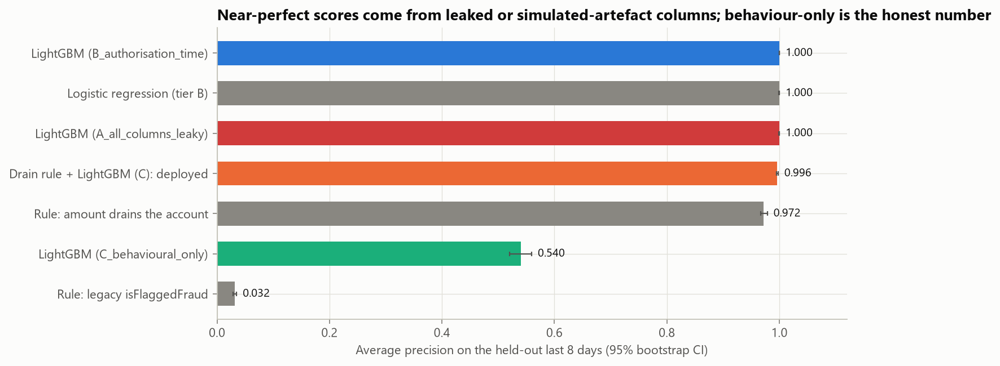
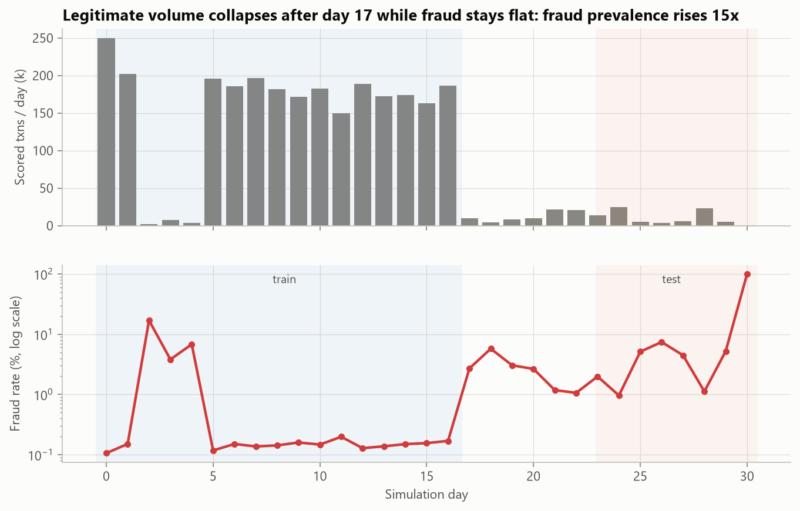
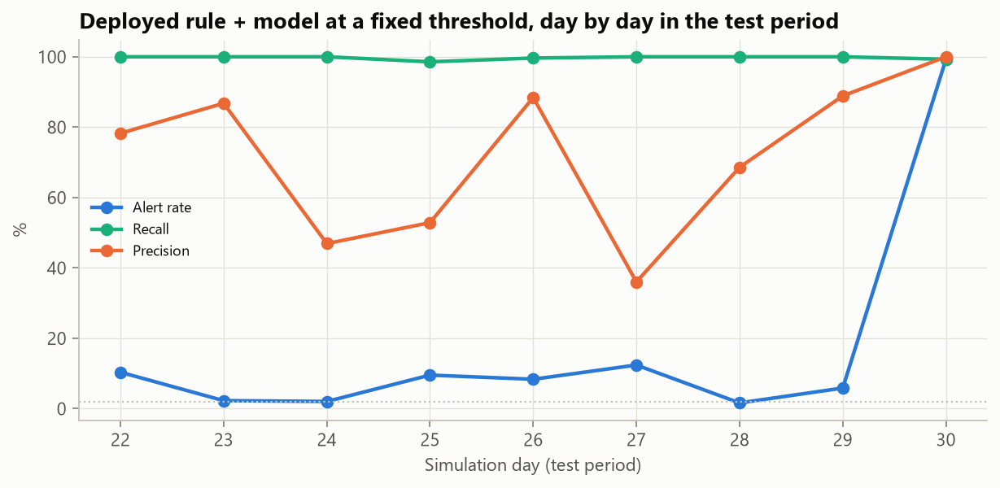

# Mobile-money fraud detection: a leakage audit, an honest model and a real-time scoring API

   

[PaySim](https://zenodo.org/records/22761688) simulates a month of mobile-money transactions from an African mobile-payments operator: 6.36 million cash-ins, cash-outs, payments and transfers, 8,213 of them fraudulent. It is one of the most-used fraud datasets on the internet, and most published models on it score close to 100%.

This project shows *why* they score that well, builds a model whose performance estimate can be trusted, and ships it as a tested scoring service with drift monitoring.

**The short version:**
- Near-perfect PaySim scores come from two sources: post-transaction balance columns (true leakage, because the simulator cancels fraudulent transfers) and a simulator artefact where **97.6% of frauds move the account's exact full balance while 0.000% of legitimate transactions do**. A one-line rule using that artefact alone reaches 0.97 average precision.
- A model restricted to behavioural signals (amount, type, hour, destination-account history) reaches **0.54 average precision and 0.93 ROC-AUC**. That is the number to expect on real data, where fraudsters do not always drain exact balances.
- The deployed design keeps the drain pattern as an explicit, auditable **business rule** and uses the behavioural model for everything else. At a threshold fixed on validation it catches **99.7% of test-period fraud (98.5% of fraud value) at 64% alert precision**, through a 15× rise in fraud prevalence.



## Results at a glance

Test period = the last 8 simulated days (82,221 transfers and cash-outs, 2,148 frauds). All models are trained on days 1–17 and tuned on days 17–23.

| Model | Features | Average precision [95% CI] | ROC-AUC |
|---|---|---|---|
| LightGBM, all columns | includes post-transaction balances (leaky) | 0.9996 | 0.9999 |
| LightGBM, authorisation-time | amount, type, hour, pre-transaction balances, destination history | 1.0000 | 1.0000 |
| Logistic regression, authorisation-time | same | 0.9996 | 1.0000 |
| Rule: amount equals the full balance | one comparison | 0.972 [0.967, 0.979] | 0.985 |
| **LightGBM, behaviour only** | amount, type, hour, destination history | **0.540 [0.521, 0.559]** | **0.926** |
| **Deployed: drain rule + behaviour model** | | 0.996 [0.995, 0.998] | 0.9999 |
| Legacy rule in the data (`isFlaggedFraud`) | transfers over 200k | 0.032 | 0.507 |

| Deployed design at a fixed threshold | Validation | Test |
|---|---|---|
| Alert rate (share of transfers and cash-outs reviewed) | 2.0% | 4.1% |
| Fraud caught (recall) | 99.4% | 99.7% |
| Fraud value caught | 97.2% | 98.5% |
| Precision of alerts | 49.7% | 64.1% |

The alert rate doubles in the test period because fraud prevalence rose 15× (0.18% in training, 2.6% in test), not because the model degraded. Precision rose too.

## The leakage audit

| Condition | Legitimate | Fraud | What it means |
|---|---|---|---|
| Amount equals the full pre-transaction balance | 0.000% | 97.6% | Simulator artefact: real legitimate users do sometimes empty an account |
| Origin balance arithmetic holds (old − amount = new) | 9.5% | 99.5% | Post-transaction leakage: fraudulent transactions were cancelled, so their balances behave differently |
| New origin balance is zero | 90.1% | 98.1% | Post-transaction |
| Legacy flag (`isFlaggedFraud`) set | 0.000% | 0.2% | The dataset's own rule catches 16 of 8,213 frauds |

Features are therefore split into three tiers, and every model is reported on all three:
- **A** — everything in the file. Shown only to quantify the leak.
- **B** — what an operator knows at authorisation time. Valid in principle, but on PaySim it inherits the artefact.
- **C** — behaviour only. The conservative estimate.

## How the deployed design works

```
transaction ──> schema validation (post-transaction fields rejected with 422)
            ──> type routing: payments, cash-ins and debits bypass the model (no fraud in those types)
            ──> feature store: destination's prior count, mean amount, hours since last credit
            ──> drain rule (amount == full balance)  ─┐
            ──> LightGBM behaviour model + isotonic   ├─> alert if rule fires OR score >= threshold
                calibration + SHAP reason codes      ─┘    response: probability, rules_triggered, reason_codes
            ──> feature store update
```

**Training/serving parity.** Destination-history features are computed in batch with Polars window functions for training and incrementally in a Python feature store for serving. [`tests/test_parity.py`](tests/test_parity.py) replays a synthetic stream through both paths and asserts they match row for row, which is the standard guard against training/serving skew.

**Time-based evaluation.** Splits follow simulated time (train days 1–17, validate 17–23, test 23–31), never a random shuffle, so every score is computed on transactions that happened after everything the model saw.

## Monitoring



| Signal | PSI, train vs test | Reading |
|---|---|---|
| Hours since the destination last received money | 3.78 | Significant shift: legitimate volume collapsed, so gaps between credits grew |
| Hour of day | 0.20 | Moderate shift |
| Model score | 0.09 | Stable |

The drift report flags the input that moved most, and the daily operations table shows recall between 98.6% and 100% on every day of the test period. A production rollout would page on input PSI above 0.25 and recalibrate the threshold to the review team's capacity.



## Serving

```bash
docker build -t fraud-api .
docker run -p 8000:8000 fraud-api
curl -X POST localhost:8000/score -H "Content-Type: application/json" \
  -d '{"step":10,"type":"TRANSFER","amount":181.0,"nameOrig":"C1","oldbalanceOrg":181.0,"nameDest":"C2","oldbalanceDest":0.0}'
# {"scored":true,"fraud_probability":...,"alert":true,"rules_triggered":["drains_account"],"reason_codes":[...],...}
```

Latency, replaying 5,000 real test-period transactions in arrival order through the in-process API (validation, feature store, model, SHAP reason codes, serialisation; no network):

| Requests | p50 | p95 | p99 |
|---|---|---|---|
| Scored transfers and cash-outs (handler) | 7.0 ms | 17.8 ms | 21.8 ms |
| All requests, incl. payments that bypass the model (handler) | 0.03 ms | 9.0 ms | 18.8 ms |
| End to end through the HTTP test client | 5.3 ms | 23.7 ms | 36.5 ms |

About 114 requests per second on a single worker. Most of the scored-path time is the per-request SHAP reason codes. Measured on a 6-core laptop while another training job was running, so treat these as upper bounds ([`reports/api_benchmark.json`](reports/api_benchmark.json)).

The GitHub Actions workflow runs the test suite, builds the Docker image, and smoke-tests `/health` and `/score` against the running container.

## Limitations

- **PaySim is simulated.** Its behavioural signals (night-time activity, transfer-then-cash-out patterns) are plausible, but the absolute numbers will not transfer. The tiered evaluation is designed to show which numbers are most likely to.
- **Account identities barely repeat.** Origin accounts appear once each in PaySim, so origin-side velocity features (the strongest real-world signals) cannot be built. Destination history is the only behavioural memory available.
- **In-memory feature store.** A production deployment would use Redis or a managed feature store keyed by account; the interface would not change.

## Reproduce

```bash
python -m venv .venv && source .venv/bin/activate     # Windows: .venv\Scripts\activate
pip install -r requirements.txt
python scripts/download_data.py      # ~470 MB from Zenodo
python scripts/run_pipeline.py       # ~5 min; writes reports/ and models/
python scripts/benchmark_api.py
pytest -q
```

## Repository structure

```
src/fraud_detection/
  config.py       time splits, feature tiers, alert budget
  features.py     batch features (Polars): destination history + transaction features
  online.py       incremental feature store used by the API
  evaluation.py   precision/recall at an alert budget, value recall, PSI, bootstrap CIs
service/app.py    FastAPI: /score, /health, /model-info
models/           LightGBM model + metadata (features, threshold, calibration, reference score quantiles)
scripts/          download_data.py, run_pipeline.py, benchmark_api.py
tests/            parity test, API contract tests, metric tests
Dockerfile, .github/workflows/ci.yml
```

## References

- Lopez-Rojas, E., Elmir, A. & Axelsson, S. (2016). *PaySim: A financial mobile money simulator for fraud detection.* EMSS. Data: [Zenodo record 22761688](https://zenodo.org/records/22761688) (CC-BY-4.0).
- See also, on Zenodo: *Code and Derived Results for "Deconstructing Near-Perfect PaySim Fraud Detection"* (record 23110657), which examines the same question from a different angle.
